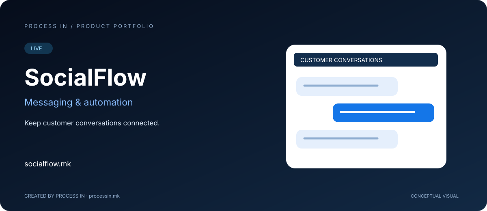

# SocialFlow

**Keep customer conversations connected.**

[English](README.md) · [Македонски](README.mk.md)

**LIVE**

## The product

SocialFlow is the PROCESS IN messaging and automation brand. Its current public experience presents a WaDesk-based workspace for WhatsApp conversations, campaign broadcasts, message templates and automated flows. This presentation describes that current public product scope without repeating the website's promotional usage figures.

## Keep the conversation and the next action connected

Customer communication involves more than sending a message. A team needs to understand the conversation, keep internal context and decide what should happen next. A campaign needs a defined audience, suitable message content and an organized sequence.

SocialFlow brings these activities into a messaging workspace. The shared inbox supports team handling; templates give recurring messages a reusable structure; flows describe the sequence of actions around a conversation. Campaigns and audience segments support more deliberate communication.

### Where the solution fits

A support team can coordinate responses and internal notes around a customer conversation. A marketing team can prepare a follow-up sequence for its intended audience. Operations can examine conversation and campaign information when reviewing the work.

The practical benefit is continuity between the message and the team's next action. Start with the customer's need, define the intended outcome and then choose the inbox, template or flow approach that fits.

## How it works

| Step | Action |
|---|---|
| 1 | Create or access the workspace |
| 2 | Configure the available messaging channel |
| 3 | Prepare templates, audience and flow |
| 4 | Launch through the product and review results |

## Core capabilities

| Area | Capabilities |
|---|---|
| **Shared inbox** | Coordinate customer conversations. |
| **Broadcasts** | Prepare audience-based messaging campaigns. |
| **Flow builder** | Compose branching conversation sequences. |
| **Templates** | Organize reusable message content. |
| **Audience segments** | Organize recipients with tags and filters. |
| **AI assistance** | The site presents a flow-building copilot. |
| **Team handling** | Assignment, notes and escalation are presented. |
| **Reporting** | Review campaign and conversation information. |

## Who it is for

Customer service, marketing and operations teams coordinating business messaging.

## Practical scenario

A support team can keep internal notes beside a conversation, while a marketing team prepares a structured follow-up flow. Channel rules and account configuration determine available actions.

## Product experience

The illustration is conceptual, not an application screenshot. The official website provides the current interface, options and terms.

## Product information

| Detail | Value |
|---|---|
| Domain | [socialflow.mk](https://socialflow.mk/) |
| Category | Messaging & automation |
| Status | LIVE |
| Developer | [PROCESS IN](https://processin.mk) |
| Portfolio contact | [contact@processin.mk](mailto:contact@processin.mk) |

Source: [Official website](https://socialflow.mk/).

### [Visit SocialFlow](https://socialflow.mk/)

[PROCESS IN — Your Enterprise Software & AI Partner](https://processin.mk)

---

Public product presentation. No proprietary source code, customer data or production secrets. No open-source license to the product is granted.

This platform is a digital product of <a href="https://processin.mk" target="_blank">PROCESS IN</a> · Your Enterprise Software & AI Partner ·  
Hosted on Enterprise Infrastructure by <a href="https://inhost.mk" target="_blank">INHOST</a> ·
